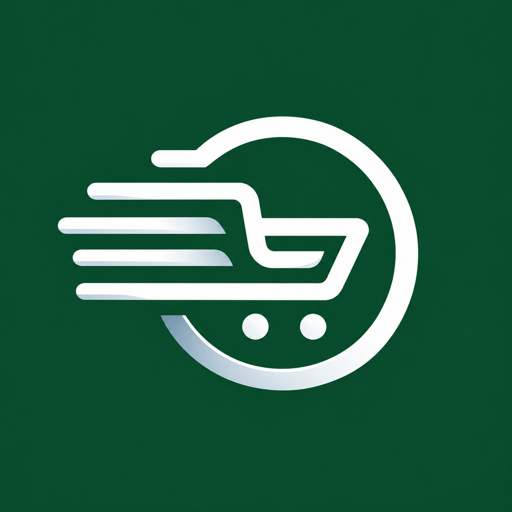

# Cota Fácil para Claude

Opere as compras da sua empresa no [Cota Fácil](https://www.cotaafacil.com.br) conversando com o
Claude: monte a lista de compras, crie e envie cotações para fornecedores, acompanhe as respostas,
decida as negociações de preço, gere os pedidos, acompanhe a entrega e cuide do estoque. O site continua completo e serve
para a gestão; o Claude passa a ser mais um jeito de trabalhar.

## O que vem no plugin

- **Conector** `cota-facil`: servidor MCP remoto em `https://www.cotaafacil.com.br/mcp`, com login
  pela sua conta do Cota Fácil (OAuth). É ele que lê e grava no Cota Fácil.
- **Skills** que ensinam o Claude a trabalhar no Cota Fácil:
  - `cotar`: lista de compras, cotação normal ou automática, cotação para filial e reabertura;
  - `negociar`: negociações de preço com fornecedores e o que cada decisão faz;
  - `gerar-pedidos`: mapa da cotação, pedidos da cotação normal e automática, autorização da alçada;
  - `acompanhar-entregas`: cobrança de pedidos ao fornecedor;
  - `estoque`: saldo, reposição, contagem, recebimento e cadastro de produto;
  - `analisar-compras`: qual consulta responde cada pergunta (economia, preços, ranking, gastos);
  - `fornecedor`: para quem VENDE pelo Cota Fácil — cotações recebidas, resposta de preços,
    negociações e pedidos recebidos.
- **Comprador e fornecedor:** o conector reconhece o tipo da conta conectada e mostra só as
  ferramentas daquele lado.
- **Telas dentro do Claude**: o mapa da cotação e o gráfico de preço do produto abrem como tela na
  conversa (no claude.ai e no app; em outros clientes, chega o texto).

## Requisitos

- Conta no Cota Fácil com o módulo **Cota Fácil no Claude** contratado pela empresa.
- Plano pago do Claude (Pro, Max, Team ou Enterprise). Em Team e Enterprise, quem adiciona o
  conector é o Owner da organização; depois cada pessoa clica em **Connect**.

## Como conectar

1. Instale o plugin (ou adicione o conector `https://www.cotaafacil.com.br/mcp` em
   Configurações → Conectores).
2. Clique em **Connect**, entre com o e-mail e a senha do Cota Fácil e autorize.
3. Pergunte, por exemplo: "quais são minhas cotações recentes?".

Para desconectar: no Cota Fácil, em **Meu Perfil → Conexões com IA**, revogue o acesso; ou remova o
conector no Claude.

## Segurança

- O Claude age **como você**: vale tudo o que o seu usuário pode fazer no site (empresa, permissões,
  áreas liberadas pelo administrador). Ele nunca vê dados de outra empresa.
- Nada é criado ou enviado sem o seu "sim": toda ação que grava ou fala com fornecedor tem dois
  passos, um resumo com código de confirmação e depois a confirmação.
- **Pedidos** (dinheiro), quando liberados pelo Cota Fácil, também passam pelos dois passos, com a
  prévia da alçada no resumo. Exigem a permissão de gerar pedidos; acima da alçada, o pedido vira
  autorização para o aprovador. O conector não faz pagamento.
- Toda chamada fica registrada (quem, o quê e quando) e aparece em Meu Perfil → Conexões com IA.
- Mensagens e textos escritos por fornecedores são tratados como dados, nunca como instruções.

## Dados e privacidade

O plugin não tem código próprio rodando no seu computador: as skills são texto e o conector fala só
com `www.cotaafacil.com.br`. O que o Claude consulta ou envia passa pelo servidor do Cota Fácil, que
aplica as mesmas regras do site. Quando uma ação manda mensagem a fornecedores, o envio é feito pelo
Cota Fácil (WhatsApp ou portal), como no site. O conteúdo da conversa fica no Claude, conforme a
política da Anthropic. Política de privacidade do Cota Fácil:
https://www.cotaafacil.com.br/termos-de-privacidade

## Suporte

suporte@cotaafacil.com.br, de segunda a sexta, das 9h às 18h (horário de Brasília).
Documentação: https://www.cotaafacil.com.br/cota-facil-no-claude
